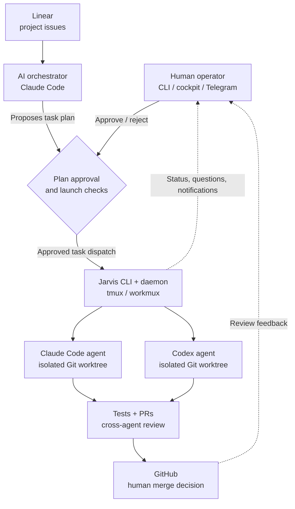

<div align="center">

# JARVIS AGENT

### One operator. Multiple coding agents. A supervised delivery pipeline.

**An open-source, personal multi-agent orchestration project that coordinates Claude Code and OpenAI Codex across software projects — from planning to pull requests, with human-controlled execution.**

[**Get started**](#quick-start) &nbsp;·&nbsp; [**Explore the architecture**](#architecture) &nbsp;·&nbsp; [**Read the French guide**](docs/README.fr.md)

<br>


</div>

---

## The idea

Running one coding assistant is useful. Coordinating several across independent projects introduces a different set of problems: **task assignment, isolation, approvals, review, visibility, and recovery**.

JarvisAgent is an experimental control plane for that workflow. Instead of asking an AI model to do everything in one conversation, it separates **orchestration** from **implementation** and keeps an operator in the loop.

| Plan | Delegate | Observe | Review |
| :--- | :--- | :--- | :--- |
| A Claude-based orchestrator organizes work from Linear issues. | Claude Code and Codex work in separate Git worktrees. | A local daemon and terminal cockpit track activity and notifications. | Agents can cross-review changes; the human decides what gets merged. |

> **Project scope:** This is an independently built personal development tool, not a Transport Canada project or an official Anthropic, OpenAI, or GitHub product.

## Architecture



**Key separation:** the orchestrator coordinates work; implementation agents modify project code. By default, proposed plans require operator approval, while merging remains a human decision.

## What it does

<details open>
<summary><strong>Orchestration and agent execution</strong></summary>

- **Multi-project planning:** turns tracked Linear issues into groups of independent tasks.
- **Mixed-agent execution:** routes work to Claude Code or Codex using workmux, tmux, and Git worktrees.
- **Approval-aware dispatch:** checks whether a task belongs to an approved plan and tracks launches to prevent reusing the same approval.
- **Second-opinion review:** supports assigning one assistant to review another assistant's pull request.

</details>

<details open>
<summary><strong>Operations and observability</strong></summary>

- **Terminal cockpit:** inspect agents, pending plans, and activity in one place.
- **Telegram controls:** approve plans, check status, pause launches, and send instructions or reference files.
- **Usage monitoring:** reads available Claude Code and Codex session/limit information to drive warnings and launch decisions.
- **Restart recovery:** records active work so it can attempt to resume after an interruption.
- **Health checks:** surfaces local machine conditions such as disk, memory, Docker, and Windows restart signals.

</details>

<details>
<summary><strong>Instructions, rules, and tool integration</strong></summary>

- Project-level `AGENTS.md` and `CLAUDE.md` templates define task, quality, and Linear conventions.
- Codex execution rules are defined in [`config/codex/jarvis.rules`](config/codex/jarvis.rules).
- Linear is connected through MCP; GitHub operations use the `gh` CLI.
- This README does **not** claim a generic hooks or skills framework is implemented in JarvisAgent. Those mechanisms can exist in the underlying assistants, but their availability depends on the installed tools and configuration.

</details>

## Quick start

**Target environment:** Ubuntu on WSL2 (Windows), or a compatible native Ubuntu/Debian environment.

**Requirements:** a GitHub account, usable Claude Code and Codex authentication, and access to Linear for the issue-based workflow. The installer will install or configure several dependencies; inspect it before execution.

**1. Install WSL / Ubuntu** if you are on Windows:

```powershell
wsl --install -d Ubuntu
```

**2. Clone and install** from an Ubuntu terminal:

```bash
sudo apt update && sudo apt install -y git
mkdir -p ~/projects && cd ~/projects
git clone https://github.com/brydel/JarvisAgent.git
cd JarvisAgent
./install.sh
```

The installer sets up the CLI, tmux, GitHub CLI, Node.js, coding assistants, workmux, and optional Linear MCP configuration. Follow its authentication prompts.

**3. Diagnose your setup:**

```bash
jarvis doctor
```

**4. Register a project and initialize its agent instructions:**

```bash
jarvis projet ajouter sample-app ~/projects/sample-app --linear "Sample App" --priorite 1
cd ~/projects/sample-app
jarvis init-project
```

The project directory must already exist. Replace the sample name and Linear project with your own.

**5. Start the control plane and orchestrator:**

```bash
jarvis start
jarvis chef
```

For optional Telegram setup, run `jarvis telegram config`.

> **WSL performance tip:** keep active Git repositories in the Linux filesystem (`~/projects/…`) rather than under `/mnt/c/`.

For the full French installation guide, cockpit key bindings, Telegram commands, settings, and troubleshooting, see **[Documentation en français →](docs/README.fr.md)**.

## A typical workflow

1. **You define priorities.** Linear holds the project's issues and acceptance criteria.
2. **The orchestrator proposes a plan.** It groups tasks and can challenge its own assumptions.
3. **You approve or reject the plan.** The CLI enforces approval-aware dispatch.
4. **Agents execute independently.** Each receives an assigned issue and a separate Git worktree.
5. **Changes are reviewed.** The workflow targets tested pull requests, with optional cross-agent review.
6. **You make the merge decision.** The orchestrator does not merge PRs on your behalf.

<details>
<summary><strong>Selected commands</strong></summary>

| Command | Purpose |
| :--- | :--- |
| `jarvis start` | Open or reconnect to the cockpit and daemon |
| `jarvis chef` | Start or join the orchestrator |
| `jarvis etat` | Inspect agents, plans, and capacity |
| `jarvis plan liste` | View proposed plans |
| `jarvis plan ok P-0001` | Approve a plan from an interactive operator session |
| `jarvis task --projet sample-app APP-42 claude` | Run an assigned issue (subject to dispatch rules) |
| `jarvis board` | Open the workmux board |
| `jarvis sante` | Check host-machine health |
| `jarvis telegram config` | Configure Telegram controls |
| `jarvis doctor` | Check dependencies and integrations |

</details>

## Trust and safety model

Autonomous coding requires boundaries, but **agent instructions are not a security sandbox**. JarvisAgent uses multiple controls, each with a different scope:

| Layer | Mechanism |
| :--- | :--- |
| Plan approval | Human approval is the default. An optional auto-approval setting exists and changes this behavior. |
| Task isolation | Git worktrees separate parallel branches and working files. |
| Agent instructions | Orchestrator and implementation agents receive role-specific restrictions. |
| Command policies | Codex rules and its sandbox configuration constrain certain operations. |
| Review boundary | Pull-request merging is reserved for the operator. |
| Operational controls | Pausing, capacity settings, usage thresholds, and local machine monitoring. |

**Important:** permissions and prefix-based command rules have limits. Review [`config/codex/jarvis.rules`](config/codex/jarvis.rules) and [`chef/CLAUDE.md`](chef/CLAUDE.md) before enabling unattended work. Do not give experimental agents unrestricted access to production systems, secrets, or sensitive work data.

## Repository map

```text
JarvisAgent/
├── bin/
│   ├── jarvis               # Main command-line entry point
│   └── jarvis-codex         # Codex launcher and sandbox setup
├── chef/
│   └── CLAUDE.md            # Orchestrator role and operating rules
├── config/
│   └── codex/jarvis.rules   # Codex command permissions
├── lib/jarvis/              # Python control-plane modules
│   ├── plans.py             # Plans and launch authorization
│   ├── daemon.py            # Agent monitoring and notifications
│   ├── cockpit.py           # Terminal interface
│   └── telegram.py          # Telegram API client
├── templates/               # Per-project agent instructions
├── tests/                   # Local test suite
├── install.sh               # Environment bootstrap
└── docs/
    └── README.fr.md         # Complete French documentation
```

## Development and status

Run the existing Python test suite:

```bash
python3 -m unittest discover -s tests -v
```

This project is actively evolving. Current source code includes the CLI, orchestrator instructions, approval tracking, workmux integration, terminal cockpit, Telegram transport, usage monitoring, and recovery utilities. Features should be evaluated against the code and tested in your own environment before relying on them.

**Documented next step:** a productivity dashboard tracking merged pull requests and agent time by subscription. See the [French project notes](docs/README.fr.md#feuille-de-route).

---

<div align="center">

**Built as a personal experiment in multi-agent software delivery.**

[Architecture](#architecture) · [Quick start](#quick-start) · [Safety model](#trust-and-safety-model) · [Guide français](docs/README.fr.md)

</div>
