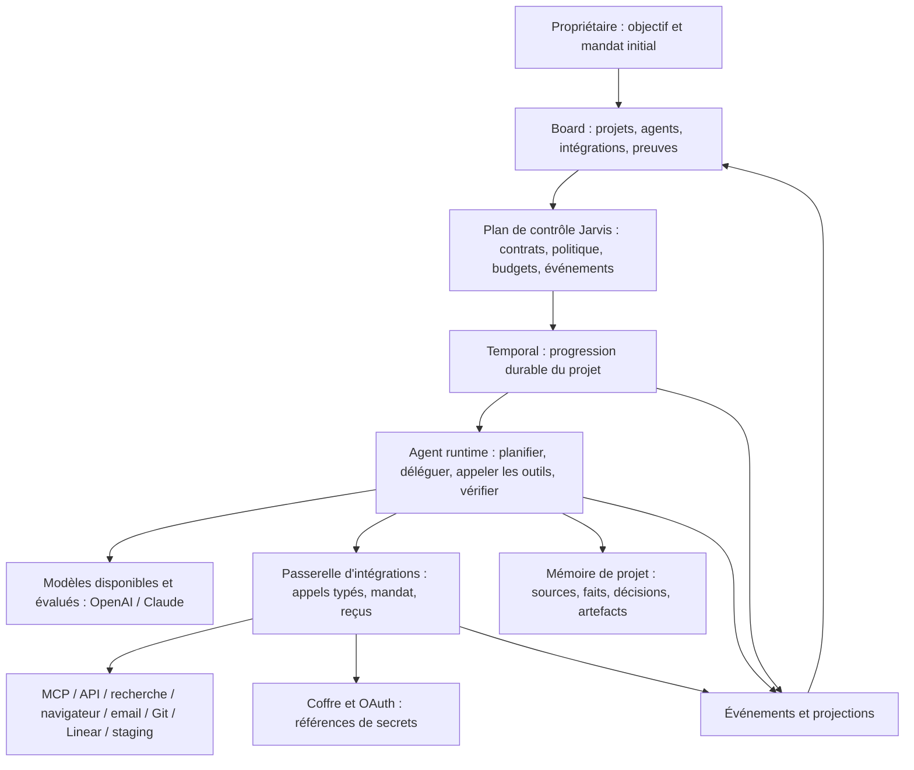

# Architecture Jarvis OS personnel

Statut : proposée après audit du code, 23 octobre 2026. L'usage personnel remplace les objectifs commerciaux
de l'ancienne feuille de route pour ce projet ; les travaux SaaS, facturation et vente n'entrent pas dans le backlog.

## Choix Temporal / LangChain / LangGraph

| Option | Ce qu'elle apporte | Décision |
| --- | --- | --- |
| Moteur Jarvis actuel | Transactions, états, baux, idempotence de résultat et reprise locale | Conservé pendant migration et pour les tâches non migrées |
| Temporal | Workflow durable, activités, signaux, timers, reprises, replay, évolution contrôlée | Cible pour projets longs ; adoption après prototype de reprise et versionnement |
| LangChain | Composants et intégrations d'applications LLM | Aucune migration générale décidée ; une dépendance ne remplace pas une connexion fonctionnelle |
| LangGraph | Graphe cognitif, état, interruptions et persistance d'agent | Prototype comparatif optionnel ; retenir uniquement si bénéfice mesuré sur notre boucle cognitive |

Temporal et LangGraph ont des zones qui se recouvrent. Notre contrat choisit Temporal comme propriétaire
du cycle de vie du projet. Les appels de modèle et d'outils sont des activités et ne sont jamais rejoués dans
le code déterministe du workflow. Si LangGraph est retenu, ses checkpoints portent un run d'agent identifié ;
ils ne réclament pas de tâches du projet ni ne rejouent indépendamment les effets externes.

La livraison ne choisit pas un runtime de modèles à partir d'un nom commercial. Comparer une boucle typée
simple et un graphe cognitif sur les mêmes tâches avec outils, reprise et qualité ; vérifier en premier les
capacités effectivement offertes par les API/CLI et l'authentification du compte. Aucune récupération ni copie
de jeton d'abonnement CLI pour fabriquer une clé API.

Sources officielles consultées pour cette décision :
- https://github.com/temporalio/sdk-python (workflows, activités, annulation, replay et tests).
- https://github.com/langchain-ai/langgraph (orchestration, persistance et utilisation sans LangChain).

## Propriété de l'état et des reprises

- Chaque mission porte `execution_engine` (`local`, `handoff_pending` ou `temporal`), `workflow_id` éventuel,
  version et corrélation. La base métier et Temporal n'ont pas de transaction commune. Le transfert passe par
  une intention en outbox écrite dans la transaction métier, un `workflow_id` stable, un démarrage idempotent
  et un rapprochement par l'état Temporal. Pendant `handoff_pending`, la file locale ne réclame plus la mission ;
  les tentatives déjà actives sont drainées ou arrêtées avant transfert. Un accusé perdu ne déclenche pas un
  second démarrage ni un retour local aveugle. Tester « workflow créé mais accusé perdu » et « intention DB
  conservée mais workflow absent ». Les clés d'opération restent stables pendant les retries.
- La base des missions conserve les contrats métier, mandats, preuves et projections du Board. Temporal
  conserve l'historique de workflow et ses checkpoints. La passerelle conserve les opérations externes et reçus.
- Un arrêt, une révocation ou une perte de bail descend jusqu'au groupe de processus et aux appels d'outils.
  Une écriture externe déjà partie ne peut pas être annulée par magie : elle doit être confirmée, rapprochée
  ou compensée. Reprendre un workflow ne signifie pas répéter tous ses effets.
- Outbox transactionnelle pour les intentions d'effets ; inbox pour événements et acquittements. Chaque effet
  porte `operation_id`, empreinte des paramètres, mandat et état `planned/running/succeeded/failed/unknown`.
- Les événements décrivent les actions : `tool.started`, `tool.finished`, `step.blocked`, `evidence.created`,
  `grant.revoked`, `run.cancelled`. Leur payload est structuré et expurgé ; les tokens ou raisonnements internes
  du modèle ne sont pas nécessaires à la traçabilité.

## Contrats communs

`AgentSpec` : version, rôle, responsabilité, modèle admissible, effort, outils requis et permis, contexte et
mémoire accessibles, plafond de dépense/temps, critères de qualité, politique de délégation et revue.

`TaskSpec` : objectif observable, dépendances, entrées/artefacts, tests d'acceptation, preuves attendues,
mandat, budget, gestion des erreurs, politique de reprise et compensation, frontière de travail mutable.

`RunSpec` : agent/task/parent IDs, état, moteur, session réelle, tentative, checkpoints, journal d'outils,
consommation, raisons d'attente et identifiants de preuves. Une carte d'agent référence un run effectif.

`IntegrationSpec` : protocole, outils et schémas découverts, mode d'authentification, scopes, état de connexion,
dernière preuve fonctionnelle, version du catalogue et référence de secret. Les états `configured`,
`authenticated`, `verified`, `degraded` et `revoked` sont différents.

`AutonomyMandate` : propriétaire, projets/dépôts, domaines/destinataires, environnements, actions autorisées,
enveloppes, durée, exceptions et règles de révocation. L'agent ne peut ni s'octroyer ni étendre ce mandat.
Le propriétaire peut préautoriser des envois, déploiements ou publications précis ; les constantes actuelles
L3/L4 et les prompts devront être harmonisés avec ce contrat, avec migration explicite et tests de régression.

## Connexions fonctionnelles

1. **Web** : recherche sourcée et navigateur Playwright isolé, pas seulement récupération d'une URL collée.
   API de recherche interchangeable ; DNS/redirections et frontières réseau contrôlés côté service.
2. **MCP** : stdio local et HTTP distant, découverte des outils, OAuth si supporté, scopes par outil/projet/rôle.
   Une autorisation globale `mcp__serveur__*` ne vaut pas mandat d'envoyer tous les emails ou déployer partout.
3. **Email** : premier fournisseur Graph ou Gmail API selon le compte disponible ; lecture, brouillon, envoi,
   recherche du reçu et réconciliation. Un connecteur SMTP générique n'est pas la première tranche.
4. **Projet logiciel** : GitHub, Linear, exécution de tests, staging, vérification navigateur et retour arrière.
5. **Extension** : documents, calendrier, autres API et webhooks après validation du premier circuit complet.

Les secrets restent dans le service de connexion et sont résolus au dernier moment ; le modèle reçoit les
capacités effectives et les résultats autorisés. Un connecteur reste utilisable quel que soit le modèle.
La séparation OS/service du coffre et du plan de contrôle doit empêcher un exécutant de modifier sa politique
ou de lire directement les tables d'identité. La future isolation porte sur les processus et les accès réels,
pas sur une instruction de prompt.

## Interface visuelle

Une section **Intégrations** permet d'ajouter MCP ou un fournisseur, se connecter, découvrir les outils,
effectuer un test réel, affecter chef/rôles/projets, inspecter les scopes et révoquer. Une modification du graphe
persistée change réellement le mandat de capacités effectives ; un dessin seul n'accorde aucun outil.

Un graphe sépare chef logique, spécialistes disponibles et sessions effectives. Il affiche les liens de
délégation, dépendances, outils appelés, dernière preuve, consommation et causes d'attente. L'inspecteur relie
une action à son reçu externe, son artefact ou son SHA vérifié. Les informations sont relues depuis les mêmes
projections que Telegram et la CLI, avec reprise de flux et détection des données périmées.

## Efficacité de l'orchestrateur

La file, les timers, budgets, limites et prérequis sont décidés par du code. Le chef est sollicité pour
décomposer un objectif, arbitrer une ambiguïté et réviser un plan, pas pour lire périodiquement tout le système.
Les spécialistes reçoivent un contexte sélectionné et des artefacts ; aucune copie systématique de toutes
les conversations. Parallélisme selon dépendances et conflits de ressources. La recherche, la production et
la revue ont des budgets distincts et une boucle de correction bornée.

Les prompts sont compilés à partir des contrats, du mandat, des outils présents et des preuves. Leur
version est évaluée sur des scénarios réels ; une nouvelle version passe en canari puis revient à la version
stable si les résultats baissent. Un modèle plus puissant ne remplace pas le scheduler ou les tests métier.
